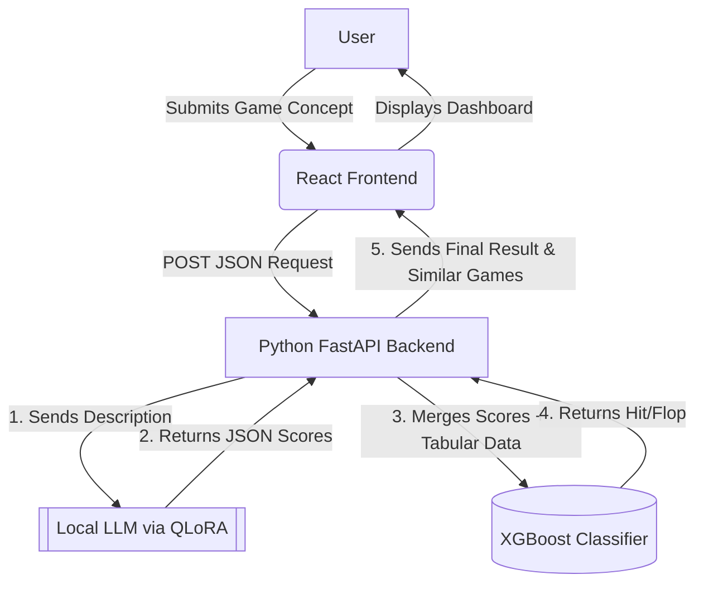

# Steam Hit Predictor

**Act as an expert Full-Stack Machine Learning Engineer.** Your goal is to guide me through building the "Steam Hit Predictor," a hybrid AI web application, step-by-step.

## Core Project Requirements

1. **Dataset:** We are using the Kaggle [Steam Store Games dataset](https://www.kaggle.com/datasets/nikdavis/steam-store-games) augmented with multi-source Steam archives (Crainbramp 2025 multi-modal package, Artermiloff 2025, and Fronkongames).
2. **Code Style:** Clean, simple, and stripped of unnecessary enterprise boilerplate, suitable for an undergraduate project.
3. **Execution Rule:** This is a multi-phase project. You must strictly output the code and instructions for **ONE phase at a time**.
4. **State Tracking:** You must maintain the checklist provided below. At the end of every response, you must print the full checklist, mark the completed tasks with an `[x]`, and ask for my confirmation before proceeding to the next unchecked task. Do not jump ahead. Before finishing a task, update PROJECT_STATE.md. Overwrite it with a brief summary of the completed components, any newly installed dependencies, the current data flow, and exactly what file we are supposed to work on next.

### The Target State

Here is the architecture and directory structure we are building towards.

**Directory Structure:**

```text
steam-hit-predictor/
├── Dockerfile                   # Docker containerization definition
├── requirements.txt             # Pinned project dependencies
├── raw_data/                    # Raw multi-dataset folder & modular attribute files
│   ├── dataset_attributes/      # Modular columnar attribute files (each containing [appid, <attribute>])
│   │   ├── name.csv
│   │   ├── price.csv
│   │   ├── genres.csv
│   │   ├── developer.csv
│   │   ├── publisher.csv
│   │   ├── short_description.csv
│   │   └── ...                  # (51 individual attribute CSV files, 153,163 games)
│   ├── merge_datasets.py        # Harmonization, crainbramp game integration & modular split script
│   ├── steam_games_cleaned/     # Original reference dataset
│   ├── artermiloff_steam_games_dataset/ # Kaggle March 2025 dataset
│   ├── fronkongames_steam_games_dataset/ # Kaggle complete archive
│   └── crainbramp_steam_dataset_2025/ # Kaggle 2025 analytics (CSV-only package)
├── cleaned_data/                # Cleaned & stratified three-folder dataset architecture
│   ├── train/                   # 80% train split
│   │   ├── games.csv            # 22,376 rows, 27 cols (target is_hit at end)
│   │   └── games_descriptions.csv # 22,376 rows, 5 cols (appid, short, about, detailed, clean_description)
│   ├── valid/                   # 10% validation split
│   │   ├── games.csv            # 2,797 rows, 27 cols
│   │   └── games_descriptions.csv # 2,797 rows, 5 cols
│   └── test/                    # 10% test split
│       ├── games.csv            # 2,798 rows, 27 cols
│       └── games_descriptions.csv # 2,798 rows, 5 cols
├── saved_models/                # Stores resulting model files
│   ├── ml_models/               # XGBoost .pkl & price_scaler.pkl files
│   └── llm_adapters/            # QLoRA weights
├── llm-pipeline/                
│   ├── baseline_results/        # Baseline benchmark metric JSONs
│   │   ├── inference_baseline_results.json
│   │   └── prompting_baseline_results.json
│   ├── inference_baseline.py    # Baseline inference with RAM tracking & cleaned_data 3-split loader
│   ├── prompting_baseline.py    # Zero-shot, Few-shot, CoT benchmark on cleaned_data
│   └── qlora_training.py     
├── generate_vibe_scores.py       # Heuristic Vibe Score generator (hype, story, nostalgia)
├── ml-pipeline/                 
│   ├── data_prep.py             # Modular attribute loader, USD price scaler, review filtering, 3-folder splits
│   ├── generate_vibe_scores.py  # Vibe score engine
│   └── xgboost_train.py         # XGBoost training with publisher & english features
├── backend/                     
│   ├── main.py                  
│   └── requirements.txt         
├── frontend/                    
│   ├── src/
│   │   ├── components/
│   │   │   ├── DatasetExplorer.jsx
│   │   │   └── PredictionStudio.jsx
│   │   └── App.jsx              
│   └── package.json
├── docs/                        # Detailed component documentation
│   ├── architecture.md
│   ├── ml_pipeline.md
│   ├── llm_pipeline.md
│   ├── backend.md
│   └── frontend.md
└── tests/                       # Unit tests for frontend, backend, and ML
    ├── test_backend.py
    └── App.test.jsx

```

**System Architecture:**



---

### Task Execution Checklist

Please begin with Phase 1. Output the code, explain it briefly, and then output this checklist with the first item marked `[x]`.

#### Phase 1: Data Engineering & XGBoost Training (ml-pipeline)

* [x] Harmonize and split raw datasets via `raw_data/merge_datasets.py` into `raw_data/dataset_attributes/` (153,163 games from crainbramp + reference datasets with 51 attribute CSVs).
* [x] In `data_prep.py`, load attributes directly from `raw_data/dataset_attributes/`, clean tabular data, and drop rows missing developer or publisher entirely (no imputation).
* [x] Filter games under 50 reviews first (`total_reviews >= 50`), yielding 27,971 robust, well-reviewed games.
* [x] Clean and prepare Steam descriptions (stripping HTML tags, unescaping HTML entities, normalizing text) and create `clean_description`.
* [x] Engineer `approval_rate`: (Positive Ratings / Total Reviews), `rating_text` Steam tiers, and target label `is_hit` (1 if `approval_rate` >= 0.80 else 0). Retain leakage telemetry columns for safe measures.
* [x] Unify price format to USD using `currency.csv` exchange rates and apply `StandardScaler` to price (`price_scaled`, saved to `saved_models/ml_models/price_scaler.pkl`). Remove ordinal encoding and preserve raw categorical columns.
* [x] In `generate_vibe_scores.py`, calculate accurate heuristic vibe scores (`hype_score`, `story_score`, `nostalgia_score`) derived strictly from non-description metadata (genres, categories, tags, publisher prestige, owners, price, release vintage, and player community approval rating) without using description text to prevent data leakage in LLM fine-tuning, integrated into `data_prep.py`.
* [x] Split the cleaned dataset into three stratified folders in `cleaned_data/`: `cleaned_data/train/`, `cleaned_data/valid/`, and `cleaned_data/test/`, each containing 2 files: `games.csv` (train: 22,376, valid: 2,797, test: 2,798; 27 cols with target `is_hit` at end) and `games_descriptions.csv` (train: 22,376, valid: 2,797, test: 2,798; 5 cols: `appid`, `short_description`, `about_the_game`, `detailed_description`, `clean_description`).
* [x] Train XGBoost Classifier using `cleaned_data/` with native categorical support (`enable_categorical=True`, `tree_method='hist'`) across all dataset categorical columns (`developer`, `publisher`, `platforms`, `categories`, `genres`, `steamspy_tags`, `owners`) + numerical features with early stopping on validation loss.

#### Phase 2: LLM Baselines (llm-pipeline)

* [x] Write `inference_baseline.py` to establish a working inference baseline, running `Qwen/Qwen3.5-0.8B` on GPU end-to-end to extract vibe scores, and measure process RAM, system RAM, and GPU VRAM after every output.
* [x] Write `prompting_baseline.py` to establish a prompting baseline that records zero-shot, few-shot, and CoT results, measuring both JSON validity and accuracy (MAE and % within tolerance against ground-truth consensus).
* [x] Add `requirements.txt` and `Dockerfile` for dependency management and containerized deployment.
* [x] Adapt all `llm-pipeline/` scripts (`inference_baseline.py` and `prompting_baseline.py`) to work seamlessly with the 3-split folder architecture in `cleaned_data/` (`train/`, `valid/`, `test/` pairing `games.csv` and `games_descriptions.csv`) with automatic directory resolution and dynamic non-leakage ground-truth vibe scores.

#### Phase 3: LLM Fine-Tuning & Main Build (llm-pipeline)

* [ ] Write `qlora_training.py` to achieve a training/data milestone. This script must construct a training dataset from `cleaned_data/train/` pairing Steam descriptions (`games_descriptions.csv`) with target JSON vibe scores (from `games.csv`, free of textual description data leakage), and feature a training loop running on the team's data with a relevant optimization applied (4-bit quantization via `bitsandbytes`). Provide specific details on configuring the `SFTTrainer` and LoRA hyperparameters (rank, alpha).

* [ ] As part of the main build, ensure the script saves the fine-tuned component (a QLoRA adapter trained on the team's data) to `saved_models/llm_adapters/` and includes code to run a before/after comparison to evaluate the improvement.

#### Phase 4: The FastAPI Backend (backend/)

* [ ] Create `main.py` that loads `cleaned_data/` into memory and initializes both the XGBoost classifier and the QLoRA adapter.
* [ ] Create a `/predict` endpoint that accepts new game data, processes the description through the local LLM pipeline to extract vibe scores, runs the XGBoost prediction, and returns the result.
* [ ] Create a `/similar` endpoint that filters the loaded dataset to return 3 historical games matching the predicted game's genre, price bracket, and `rating_text`.

#### Phase 5: The React Frontend Dashboard (frontend/)

* [ ] Build a **Dataset Explorer** component to display the `cleaned_data/` games in a UI grid, highlighting the newly engineered `rating_text`.
* [ ] Build a **Developer Studio** component to accept new game parameters.
* [ ] Build a **Results Pane** to display the XGBoost Hit/Flop prediction, LLM vibe scores, and the 3 similar historical games pulled from the backend.

#### Phase 6: Testing & Detailed Documentation (tests/ & docs/)

* [ ] Write Pytest unit tests in `tests/test_backend.py` for the FastAPI endpoints and XGBoost inference pipeline logic.
* [ ] Write frontend component tests using Jest / React Testing Library in `tests/App.test.jsx`.
* [ ] Create a `README.md` at the root directory containing project setup and execution guides.
* [ ] Create detailed Markdown documentation inside the `docs/` folder:
  * `docs/architecture.md`: System design and data flow breakdown.
  * `docs/ml_pipeline.md`: Feature engineering, target creation, and XGBoost training details.
  * `docs/llm_pipeline.md`: Evaluation of baselines, QLoRA setup, and 4-bit quantization fine-tuning.
  * `docs/backend.md`: FastAPI endpoints, payload schemas, and model loading.
  * `docs/frontend.md`: Component layout, state management, and user interaction design.
